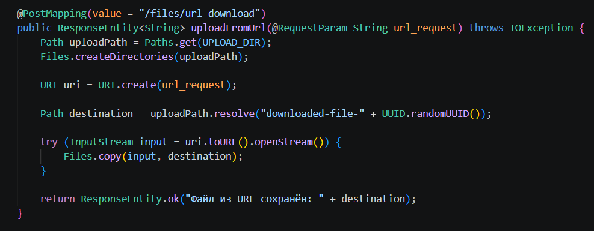
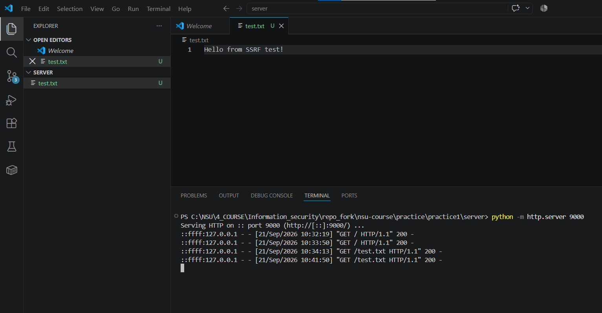
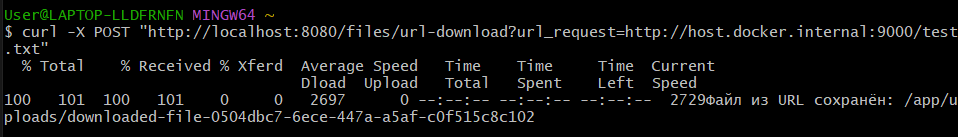
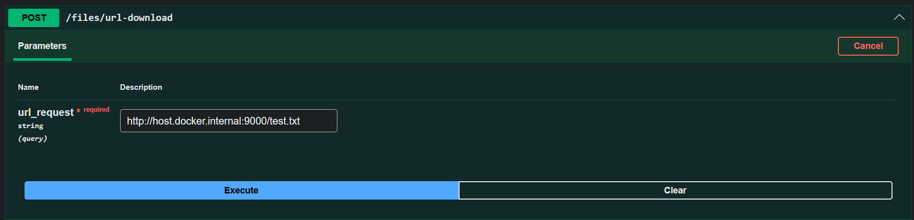
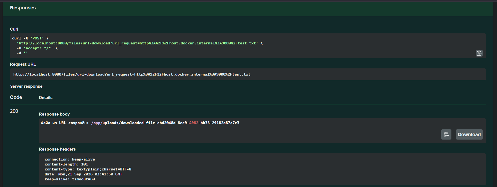
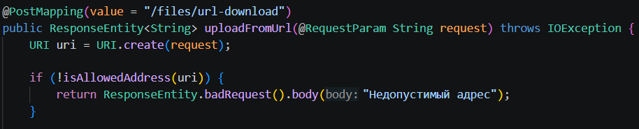
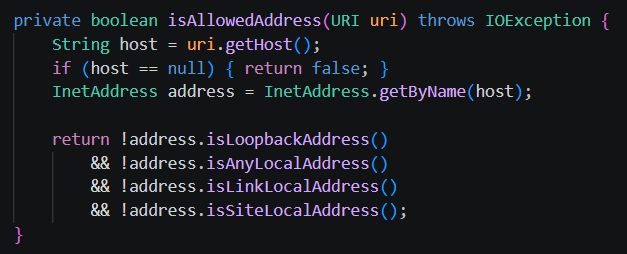
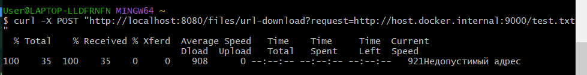
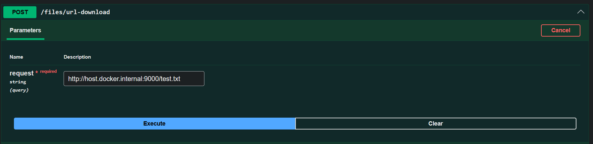
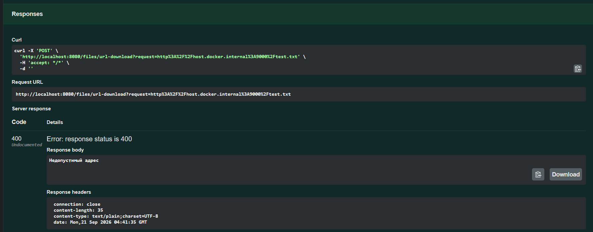

1. Выбрать уязвимость из списка ниже и внедрить ее в свой форк
2. Написать PoC-эксплойт в формате curl-запроса или скрипта (python, js - любой)
3. Описать суть уязвимости текстом, прикрепить скриншот успешной эксплуатации
4. Реализовать исправление (в отдельном методе или отдельной функцией, параметром) и описать суть исправления текстом

# Уязвимость - Server-Side Request Forgery (SSRF)

**Server-Side Request Forgery (SSRF)** или подделка запросов на стороне сервера -- уязвимость безопасности, которая позволяет злоумышленнику заставить уязвимый веб-сервер отправлять произвольные HTTP-запросы от своего имени.

Код: URI в виде String передаётся в эндпоинт в URL запроса, по нему открывается stream и устанавливается содержимое.

Поднимем сервер localhost:9000, на котором будет расположен файл test.txt. 

Сервер с файлом text.txt:

# Эксплоит

После получения URI сервер без проверки сам выполняет запрос по этому адресу от своего имени. Файерволы/брандмауэры воспринимают запрос как легитимный, так как исходит от сервера. Злоумышленник таким образом может не только передавать ссылки на файлы для скачивания (что по идее должен предоставлять эндпоинт), но и заставить сервер выполнить произвольный запрос к любому хосту/порту, доступным серверу (в том числе к внутреннему содержимому), и в ряде случаев получить содержимое ответа.

Здесь проверяется возможность выйти серверу за пределы доменной зоны внутренней сети.

Аналогичные действия через Swagger:

# Исправление

Для разрешения SSRF следует разрешить несколько проблем:
1. Разрешить только протоколы http:// и https:// (запретить использование ftp: и другие без нужды)
2. Запретить обращаться к внутренней доменной зоне
3. Отключить редиректы (или контролировать каждый редирект)
4. Ограничения запроса (timeout, ограничения размера и пр.)

В контексте PoC-эксплоита необходимо запретить обращаться к какому-либо локальному адресу.

Вносим соответствующую проверку для полученного uri:

Теперь посмотрим на результат работы эксплоита:

Получаем ответ 400, что и ожидалось.